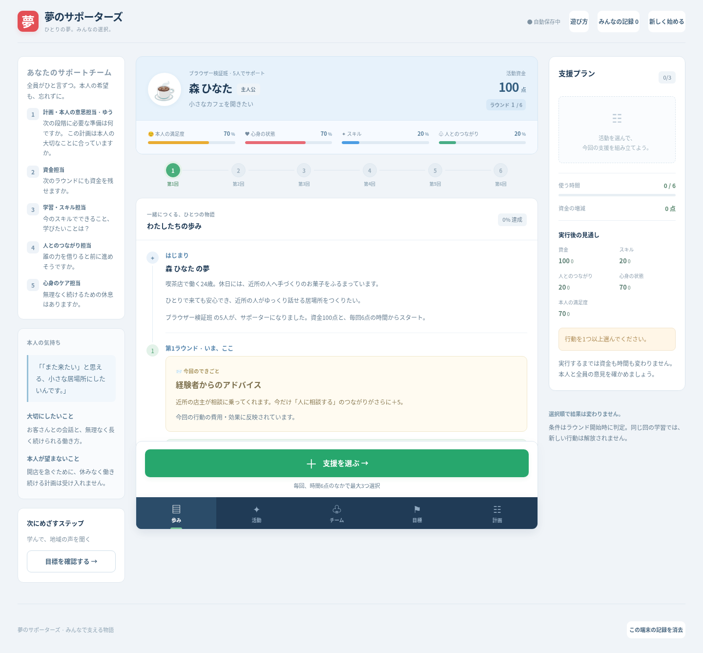
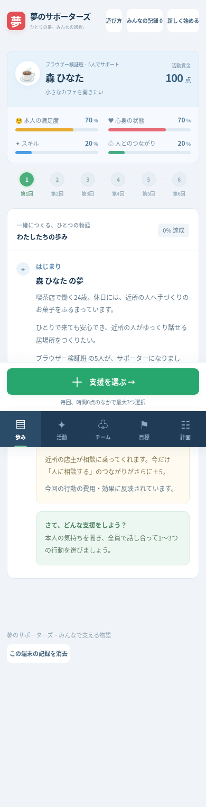

# 夢のサポーターズ

5〜6人がひとつの画面を囲み、架空の主人公の夢を応援する日本語の協力シミュレーションです。カフェ、短編漫画、地域の音楽イベントの3つの物語を収録しています。1ゲームは全6ラウンド、話し合いを含めて約15〜25分です。

BitLifeの画面構成を参考に、主人公のプロフィール、状態バー、ラウンドごとの歩み、下部ナビゲーションを中心とした画面にしています。遊び方は従来どおり、5〜6人で相談して主人公を支える協力ゲームです。



<details>
<summary>スマートフォンの画面を見る</summary>



</details>

**まず遊んでみる**：[release/play.html](release/play.html)をダウンロードし、ローカルHTMLを許可するブラウザーで開いてください。GitHubのファイル画面ではソースが表示されるため、ファイルを保存するか「Code → Download ZIP」でリポジトリを取得します。この単一ファイルにはJS・CSSを含み、npmのインストールは不要です。

## 起動

開発する場合はNode.js 20.19以降の20系、または22.12以降とnpmが必要です。この環境ではNode.js 24で動作確認しています。リポジトリを取得したあと、そのディレクトリで実行します。

```sh
cd aki-zemi
npm ci
npm run dev -- --port 5173
```

Viteが表示するアドレスをブラウザーで開いてください。クラウド環境では、利用するホストのポート公開機能が必要です。サーバーはポート5173で待ち受けます。

**単一ファイル版**：`npm run build`は`dist/play.html`と同じ内容を`release/play.html`にも生成します。GitHubに保存する配布版は`release/play.html`です。ファイルの直接表示を許可しているブラウザーでは、パソコンに保存して開けます。管理されたブラウザーなど、`file://`の表示が制限されている環境では、本番プレビュー経由で`play.html`を開いてください。通常の`dist/index.html`はWebサーバー経由で開いてください。ファイルを移動したり別名にすると、ブラウザーによって保存先が変わる場合があります。

```sh
npm test          # 実際のゲームルールを使う16項目のテスト
npm run build    # TypeScriptの検証と本番用dist/の生成
npm run preview  # 本番用ビルドを確認
```

ゲーム中に外部API、ログイン、データベースは使いません。初回の依存関係インストールにはnpmレジストリーへの通信が必要です。

## 遊び方

1. 夢を選び、主人公の背景・希望・受け入れられない方法を読みます。
2. グループ名、人数、担当を決めます。担当者名の記入は任意です。5人の場合は計画担当と本人の意思担当を兼ねます。
3. 毎回の固定イベントを読み、1〜3個の異なる行動を選びます。時間は毎回6点、資金は初期100点です。未使用の時間は持ち越せません。
4. 予定する支出・収入と実行後の状態を見て、全員で確認してから実行します。選択や取消しだけでは数値は変わりません。
5. 第3ラウンドでは、本人が納得する2つの方針から1つを選びます。方針の費用・時間・効果も同時に精算します。
6. 前提条件はラウンド開始時に判定し、行動と方針をまとめて精算します。選択順による違いはありません。同じ回の学習で新しい行動を解放することはできません。
7. 最終実行を終えた場合は早めに振り返るか、第6ラウンドまで心身などを整えられます。第6ラウンドを実行すると必ず結算します。

夢の進捗は3つのステージを等しい重みで計算します。各ステージ内では完了した課題の割合を使い、一度完了した課題は保持します。資金は0以上、ほかの状態は0〜100に制限します。無理なく続けられる目安は心身50以上・満足度60以上です。漫画の受賞や売上は達成条件に含めません。

資金がないときにも「現状を振り返る」「人に相談する」「休息を取る」「本人と話し合う」を選べます。振り返りに数値の増加はありません。

## 画面の見方

主人公のプロフィールには、現在の資金と、スキル・人とのつながり・心身の状態・本人の満足度の4つの状態を表示します。下部のメニューで、相談に必要な情報を切り替えます。

- **歩み**：今回のできごとと、これまでのラウンドの記録。
- **活動**：支援する行動の選択と取消し。第3ラウンドでは本人と方針も選びます。
- **チーム**：グループの担当と、それぞれの話し合いの視点。
- **目標**：夢に向かう3つのステージと、課題の達成状況。
- **計画**：選んだ支援、時間・資金、実行後の見通しの確認。

大きな進行ボタンから支援の選択、計画の実行、次のラウンドへ進みます。行動を選ぶだけでは実行されません。全員で計画を確認してから実行してください。

## 記録

現在の進捗、選択中の行動、担当者名、終了したグループの結果と4つの振り返り欄は、`localStorage`の`yume-supporters-v1`に自動保存します。新しいゲームを始めても終了した結果は残ります。全記録の消去は確認画面を経て行います。

比較は同じブラウザーの記録だけが対象です。他の端末やブラウザーと同期しません。グループは保存順で表示し、総合得点や順位はつけません。夢ごとに条件が異なるため、数値は話し合いの参考にしてください。保存を制限するブラウザーでは警告を表示し、その画面でのプレイは継続できます。

## 内容・ルールを変更する

- `src/game/data.ts`：主人公、背景、意思、役割、共通行動、夢固有の行動、6つの固定イベント、ステージ条件、初期値、持続可能性の目安をまとめています。`EXAMPLE_PATH`は実際に通過できる参考経路です。
- `src/game/types.ts`：データ形式。
- `src/game/engine.ts`：開始時点の条件判定、イベント反映、予測、実行、進捗、結局と記録に基づくフィードバック。
- `src/game/storage.ts`：ブラウザー保存と読み込み時の基本検証。
- `src/App.tsx` / `src/styles.css`：日本語の画面とレスポンシブ表示。
- `scripts/inline-build.mjs`：ビルド済みのJSとCSSをまとめ、単独で開ける`dist/play.html`と配布用の`release/play.html`を生成します。

行動の`cost`は正数なら支出、負数なら収入です。イベントの調整値は、その回に選んだ行動にだけ反映します。`once`付き行動は1ゲーム1回です。条件の`minStats`は開始時の値、`actions`は前のラウンドまでに終えた行動IDを参照します。条件や費用を変更したら、`npm test`で3つの夢の到達可能性を再確認してください。

開発用の参考経路は、各ラウンドを次の順で進めます（画面には攻略を表示しません）。

| 回 | 行動ID | 方針 |
|---|---|---|
| 1 | study, research, consult | — |
| 2 | study, consult, rest | — |
| 3 | practice, rest | care |
| 4 | improve, work, rest | — |
| 5 | final, consult, rest | — |
| 6 | reflect, rest, consult | — |

## ブラウザー検証

`tests/browser_smoke.py`はPythonのPlaywrightとChromiumを使う追加の操作テストです。開発サーバーを起動してから実行します。通常のゲーム実行にPythonは不要です。

```sh
python3 tests/browser_smoke.py
# 別のターミナルで npm run preview -- --port 4173 --strictPort を起動後：
GAME_URL=http://127.0.0.1:4173/play.html python3 tests/browser_smoke.py
```

## 範囲

同じ端末を囲む教学用の初版です。通信型の同時参加、アカウント、オンライン共有、外部AI、ランダムイベントはありません。3つの夢で基礎値をそろえていますが、厳密な公平性を検証したものではありません。
